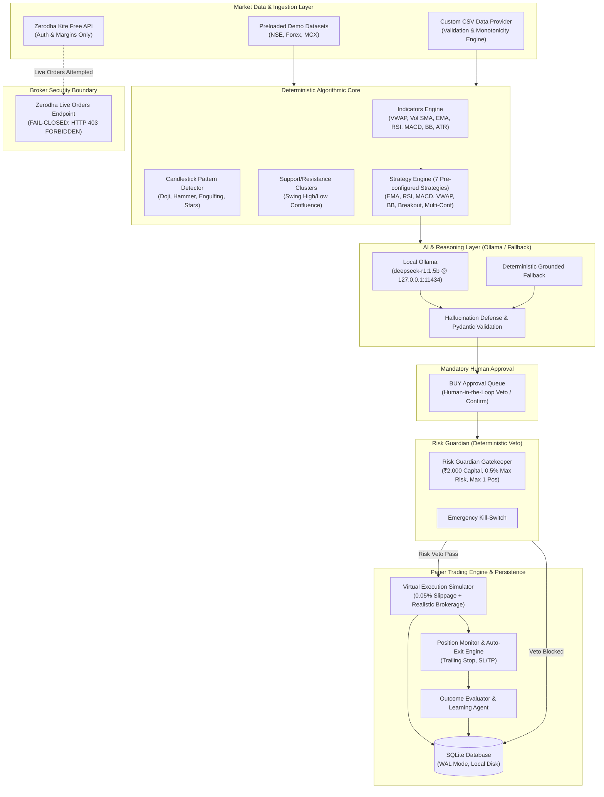

# Vibe Trading AI — System Architecture & Design Specification

## 1. Executive Summary

**Vibe Trading AI** is a local-first, zero-subscription, hybrid quantitative and AI trading analysis and paper simulation platform designed specifically for personal laptops. Initially calibrated for **Indian Markets (NSE Equities)** with multi-market capability (Forex and MCX Commodities), the platform adheres strictly to the fundamental paradigm:

> **Algorithm calculates. AI reasons and explains. Risk Guardian validates. User approves. Paper Engine simulates. Outcome Evaluator measures performance.**

---

## 2. Core Architectural Principles

1. **Deterministic Calculation Integrity**: All mathematical indicators (EMA, SMA, RSI, MACD, Bollinger Bands, ATR, VWAP, Volume SMA) and 7 core strategies are computed with pure Python (NumPy/Pandas) with zero stochastic drift.
2. **Local-First Zero Cost**: All components run locally on the developer's laptop with zero cloud bills. Uses local SQLite persistence, Vite React frontend, and local Ollama inference (`deepseek-r1:1.5b`).
3. **Mandatory Human-in-the-Loop**: Zero automated BUY orders. Every buy opportunity enters the **BUY Approval Queue (Step 4)**, requiring explicit human inspection of parameters, risk, and rationale before simulated entry.
4. **Deterministic Risk Guardian**: Independent risk gatekeeper with absolute veto authority. Evaluates capital limits (default ₹2,000 demo calibration), max 0.5% risk per trade (₹10.00 max risk), max 1 open position, daily loss stops, and emergency kill switches.
5. **Fail-Closed Live Broker Safety**: Integrated with **Zerodha Kite Connect Personal (Free)** solely for account authentication, user identity verification, and margin surveillance. Live broker order placement is strictly blocked with **HTTP 403 Forbidden** and permanent audit logging.
6. **Anti-Hallucination AI Grounding**: LLM outputs are forced into strict Pydantic schemas. If local Ollama is offline or generates unverified claims, the platform seamlessly switches to deterministic rule-grounded explanations.

---

## 3. High-Level System Architecture Diagram

---

## 4. Subsystem Breakdown

### 4.1 Deterministic Algorithmic Core
- **Indicators**:
  - `EMA` (9, 21, 50, 200) and `SMA` (20, 50, 200)
  - `RSI` (14) with Wilder smoothing
  - `MACD` (12, 26, 9)
  - `Bollinger Bands` (20-period, 2.0 std dev)
  - `ATR` (14-period true range)
  - `VWAP` (Typical price $\times$ volume cumulative sum)
  - `Volume SMA` (20-period moving average)
- **7 Pre-configured Strategies**:
  1. `STRAT-EMA-CROSS`: Fast/Slow EMA Trend Follower
  2. `STRAT-RSI-REV`: RSI Oversold/Overbought Mean Reversion
  3. `STRAT-MACD-MOM`: MACD Signal & Histogram Crossover Momentum
  4. `STRAT-VWAP-TREND`: VWAP Intraday Directional Bias
  5. `STRAT-BB-REV`: Bollinger Band Mean Reversion
  6. `STRAT-VOL-BREAKOUT`: Volume-Confirmed Price Range Breakout
  7. `STRAT-MULTI-CONF`: Multi-Indicator Confluence Engine

### 4.2 AI Reasoning & Hallucination Defense
- **Provider Abstraction**: Unified `BaseAIProvider` interface with `OllamaProvider` (default model `deepseek-r1:1.5b`) and `DeterministicFallbackProvider`.
- **Hallucination Defense**:
  - Validates all generated rationale against underlying indicator arrays.
  - Rejects unsupported price targets and fabrications.
  - Tracks quality metrics: input completeness %, data freshness, schema validity, model latency, and claims rejected.

### 4.3 Risk Guardian Gatekeeper
- **Default ₹2,000 Virtual Capital Calibration**:
  - Default simulated balance: ₹2,000.00
  - Maximum risk per trade: 0.5% (₹10.00)
  - Maximum daily loss limit: ₹40.00
  - Maximum concurrent open positions: 1
  - Max single position size: 20% (₹400.00)
- **Deterministic Veto**: Risk rules execute prior to order generation and cannot be overridden by AI confidence scores.

### 4.4 Broker Integration & Fail-Closed Live Shield
- **Zerodha Kite Connect Personal (Free)**:
  - Supports personal API Key and Secret authentication.
  - Returns connection status, user ID, profile name, and simulated margin.
  - **Live Order Endpoint (`POST /api/broker/zerodha/orders`)**: Strictly raises HTTP 403 Forbidden with security audit log entry.
