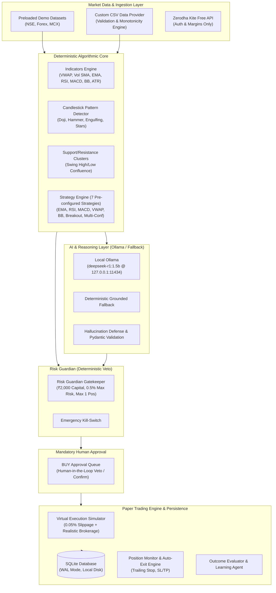

# Vibe Trading AI — Algorithm + AI Hybrid Trading Platform

> **A local-first, zero-cloud-cost, hybrid quantitative analysis and paper-trading platform designed for Indian Markets (NSE Equities), Forex, and MCX Commodities.**

---

## ⚖️ Financial & Simulation Disclaimer

> **CRITICAL NOTICE**: Vibe Trading AI is designed strictly for educational, research, quantitative algorithm backtesting, and paper-trading simulation purposes. 
> 
> - **PAST AND SIMULATED PERFORMANCE DOES NOT GUARANTEE FUTURE RESULTS.**
> - **NO REAL MONEY IS RISKED OR EXCHANGED.**
> - **LIVE BROKER ORDER EXECUTION IS STRICTLY DISABLED (HTTP 403 FAIL-CLOSED).**
> - Algorithmic backtesting and paper trading rely on theoretical assumptions, historical datasets, and simulated execution conditions that may differ significantly from real-world market liquidity, wide bid-ask spreads, exchange outages, and slippage.
> - Nothing in this repository constitutes investment advice, financial advisory, or a recommendation to buy or sell securities.

---

## 🏛️ System Philosophy & Core Paradigm

Vibe Trading AI is engineered around a strict separation of responsibilities:

$$\text{Algorithm Calculates} \longrightarrow \text{AI Reasons \& Explains} \longrightarrow \text{Risk Guardian Validates} \longrightarrow \text{User Approves} \longrightarrow \text{Paper Engine Simulates} \longrightarrow \text{Outcome Evaluator Measures}$$

### Non-Negotiable Operational Guardrails
1. **Mandatory Human-in-the-Loop**: Zero automated BUY orders. Every potential trade must be reviewed and explicitly authorized by the user in the **BUY Approval Queue**.
2. **Fail-Closed Live Broker Safety**: Integrated with **Zerodha Kite Connect Personal (Free)** exclusively for identity and margins inspection. Live broker order placement is strictly blocked at the API barrier with **HTTP 403 Forbidden** and permanent audit logging.
3. **Deterministic Calculations First**: All indicators, candlestick patterns, and 7 strategies are calculated with pure NumPy/Pandas. AI is used solely for explanatory synthesis and confluence evaluation.
4. **Anti-Hallucination AI Defense**: Local Ollama model (`deepseek-r1:1.5b`) inferences are constrained by strict Pydantic schemas. If ungrounded claims are detected or Ollama is offline, the platform automatically falls back to deterministic rule-grounded explanations.
5. **₹2,000 Indian Market Calibration**: Calibrated by default for small-account testing with ₹2,000 virtual balance, 0.5% max risk per trade (₹10.00), max 1 open position, and a ₹40.00 daily loss stop.

---

## 🏗️ System Architecture

Vibe Trading AI is built with a local-first, decoupled architecture:



### The 8 Logical Agent Responsibilities
1. **Perception Agent**: Collects validated OHLCV feeds, enforces timestamp freshness, and flags stale candles or time gaps.
2. **Reasoning Agent**: Evaluates indicator confluences, detects directional conflicts, and synthesizes market regime bias.
3. **Memory Agent**: Recalls historical setup performance from SQLite and calculates regime-specific empirical win rates.
4. **Learning Agent**: Monitors strategy performance decay, expectancy drift, and rolling statistical metrics.
5. **Planning Agent**: Selects candidate strategies aligned with the active market regime; defaults to `NO_TRADE` when conditions are ambiguous.
6. **Risk Guardian Agent**: Independent deterministic gatekeeper with absolute veto authority over position sizing, portfolio exposure, daily loss stops, and emergency kill switches.
7. **Trade Manager Agent**: Oversees virtual paper execution, slippage simulation, broker fee accounting, and guarded autonomous exits.
8. **Outcome Evaluator Agent**: Post-trade analysis assessing execution quality, target attainment, stop-loss adherence, and journal records.

---

## 📈 7 Pre-Configured Algorithmic Strategies

1. `STRAT-EMA-CROSS`: **Fast/Slow EMA Trend Follower** — Detects bullish crossovers of 9 EMA over 21 EMA with 200 EMA trend filtering.
2. `STRAT-RSI-REV`: **RSI Mean Reversion** — Identifies oversold rebounds ($RSI < 30 \to > 35$) with support zone confirmation.
3. `STRAT-MACD-MOM`: **MACD Histogram Crossover** — Capitalizes on MACD signal line crossovers accompanied by positive histogram expansion.
4. `STRAT-VWAP-TREND`: **VWAP Intraday Directional Bias** — Intraday trend following when price sustains above Volume-Weighted Average Price.
5. `STRAT-BB-REV`: **Bollinger Bands Mean Reversion** — Detects price touching lower 2.0-std band with subsequent reversal candle confirmation.
6. `STRAT-VOL-BREAKOUT`: **Volume-Confirmed Range Breakout** — Signals price breakouts above 20-period highs accompanied by $1.5\times$ Volume SMA surge.
7. `STRAT-MULTI-CONF`: **Multi-Indicator Confluence Engine** — Requires 3 or more independent indicators (EMA, RSI, MACD, Patterns) to align before signaling candidate status.

---

## 🤖 Local AI & Hallucination Defense

Vibe Trading AI integrates local **Ollama** running the lightweight `deepseek-r1:1.5b` model:
- **Zero Cloud API Subscriptions**: Runs 100% locally on standard laptop hardware (CPU or GPU).
- **Strict Pydantic Encoders**: Outputs must strictly conform to the `AIAnalysisResponse` schema.
- **Grounded Verification**: Rationale is cross-verified against actual computed indicator numbers; unsupported claims are filtered out.
- **Deterministic Fallback**: If Ollama is offline or unreachable, the system automatically falls back to deterministic rule-based analysis without failing requests or halting simulation (`is_trade_authorization=False`).

---

## 🛡️ Risk Guardian & Paper Trading Assumptions

### Risk Controls (Default ₹2,000 Indian Market Calibration)
- **Virtual Initial Balance**: ₹2,000.00
- **Max Risk Per Trade**: 0.5% (₹10.00 max risk exposure per position)
- **Max Open Positions**: 1 active position
- **Max Position Size**: 50.0% of portfolio value
- **Daily Loss Limit**: ₹40.00 cumulative loss circuit breaker
- **Emergency Stop**: Global kill-switch halts all new proposal generation instantly

### Execution Simulation Modeling
- **Adverse Micro-Slippage**: Simulated market orders execute with 0.02% to 0.05% adverse slippage.
- **Brokerage & Statutory Charges**: Realistic simulation of Zerodha-style discount pricing (₹2.00 to ₹20.00 brokerage + STT + GST + exchange turnover charges).
- **Autonomous Exits**: Once a position is opened with user approval, the autonomous exit engine is authorized **only** to manage risk (Stop Loss, Take Profit, Trailing Stop) for that specific open position. It cannot open new positions or increase risk.

---

## 📊 Backtesting Engine & Limitations

The quantitative backtesting engine (`POST /api/backtesting/run`) features:
- **Strict Chronological Evaluation**: Dynamic dispatch across all 7 strategies with causal sequential candle indexing to eliminate future look-ahead bias.
- **In-Sample / Out-of-Sample Splitting**: Supports standard 70/30 chronological data splits for out-of-sample validation.
- **Overtrading & Turnover Metrics**: Quantifies trade frequency, max drawdown, win rate, profit factor, and mathematical expectancy.
- **Limitations**: Backtests assume complete liquidity at candle close/open prices, do not simulate exchange queue priority, and reflect historical market regimes that may not persist in the future.

---

## 🔒 Zerodha Kite Connect Free Integration

- **Read-Only Surveillance**: Used exclusively for user identity verification and margin balances.
- **Fail-Closed Live Barrier**: The live order endpoint (`POST /api/broker/zerodha/orders`) strictly returns **HTTP 403 Forbidden**. Live broker trading is completely disabled.
- **Credential Protection**: Server-side environment isolation; API keys and secrets are never exposed to the frontend, browser storage, or LLM context.

---

## 🛠️ Step-by-Step Local Setup & Execution Guide

### Prerequisites
- **Python 3.10+** (Tested on Python 3.12)
- **Node.js 18+** (Tested on Node v20/v22/v24 and npm 10/11)
- **PowerShell 5.1+ or 7+** (Windows) or **Bash** (macOS/Linux)
- **Ollama** (Optional, for local AI inference)

---

### Step 1: Install Dependencies

#### Backend (Python)
From the repository root:
```powershell
cd backend
python -m venv venv
.\venv\Scripts\activate
python -m pip install --upgrade pip
pip install -r requirements.txt
cd ..
```

#### Frontend (React / Vite)
From the repository root:
```powershell
cd frontend
npm install
cd ..
```

---

### Step 2: Configure Environment

Copy the example configuration to `.env`:
```powershell
Copy-Item .env.example .env
```
*(The default configuration runs out of the box with zero external dependencies and simulated demo mode enabled).*

---

### Step 3: Start Local Ollama (Optional)

If using local AI inference:
```bash
# 1. Install Ollama from https://ollama.com
# 2. Pull the lightweight reasoning model:
ollama pull deepseek-r1:1.5b

# 3. Verify Ollama is running:
curl http://127.0.0.1:11434/api/tags
```
*(If Ollama is not installed or offline, Vibe Trader AI automatically uses the deterministic fallback engine).*

---

### Step 4: Run Demo Mode

#### Terminal 1 — Start FastAPI Backend:
```powershell
cd backend
.\venv\Scripts\activate
python -m uvicorn main:app --host 127.0.0.1 --port 8000 --reload
```
- Interactive API Docs: `http://127.0.0.1:8000/docs`
- Health Endpoint: `http://127.0.0.1:8000/api/health`
- Demo Overview: `http://127.0.0.1:8000/api/market/demo`

#### Terminal 2 — Start Vite React Frontend:
```powershell
cd frontend
npm run dev -- --host 127.0.0.1 --port 5173
```
- Web Application: `http://127.0.0.1:5173`

---

## 🧪 Running the Complete Test Suite

The repository includes a comprehensive 167-test automated verification suite:

```powershell
# 1. Run Backend Pytest Suite (152 Tests)
cd backend
.\venv\Scripts\pytest ..\tests\backend -v
cd ..

# 2. Run Frontend Vitest Suite (15 Tests)
cd frontend
npm test -- --run

# 3. Verify Production Frontend Build & TypeScript Compilation
npm run build
cd ..
```

### Test Suite Coverage Breakdown

| Test File | Test Count | Focus Area |
| :--- | :---: | :--- |
| `tests/backend/test_api.py` | 5 | Core API endpoints & health |
| `tests/backend/test_autonomous_workflow.py` | 8 | End-to-end proposal $\to$ approval $\to$ paper trade flow |
| `tests/backend/test_backtesting_engine.py` | 5 | Strategy backtesting & metrics |
| `tests/backend/test_phase2_crud.py` | 8 | SQLite database persistence & models |
| `tests/backend/test_step3_e2e_verification.py` | 17 | End-to-end multi-agent execution & risk vetoes |
| `tests/backend/test_step4_agent_optimization.py` | 14 | LLM call minimization & deterministic execution |
| `tests/backend/test_step5_algorithm_validation.py` | 30 | 7-strategy mathematical integrity & reproducibility |
| `tests/backend/test_step6_paper_trading_stress.py` | 22 | Stress testing, concurrency, idempotency & accounting |
| `tests/backend/test_step7_security_audit.py` | 22 | Input fuzzing, injection defense, fail-closed broker barrier |
| `tests/backend/test_step8_multiday_paper_trading.py`| 8 | Multi-day chronological paper simulation & reconciliation |
| `tests/backend/test_technical_analysis.py` | 4 | Indicator calculations & pattern detection |
| `tests/backend/test_vibe_intelligence_core.py` | 9 | 8-agent core orchestration & lifecycle |
| `frontend/src/App.test.tsx` | 15 | React UI navigation, tabs, rendering & badges |
| **TOTAL AUTOMATED TESTS** | **167** | **100% Passing (167 / 167)** |

---

## 📁 Repository Structure

```
vibe-trader-ai/
├── .env.example                     # Environment template (placeholders only)
├── .gitignore                       # Git ignore rules (ignoring .env, *.db, dist, etc.)
├── API.md                           # REST API endpoint reference
├── ARCHITECTURE.md                  # Comprehensive system architecture & dataflow
├── pytest.ini                       # Pytest configuration
├── README.md                        # Master documentation & setup guide
├── SECURITY.md                      # Security model, fail-closed policy, and audit trail
├── TESTING.md                       # Comprehensive testing strategy & suite breakdown
├── TRADING_SIMULATION_ASSUMPTIONS.md# Modeling assumptions, fees, slippage, and limitations
│
├── backend/
│   ├── app/
│   │   ├── api/v1/                  # FastAPI modular route handlers
│   │   ├── core/                    # Application settings and configuration
│   │   ├── database/                # SQLite connection and session management
│   │   ├── market_data/             # Synthetic and historical candle generators
│   │   ├── models/                  # SQLAlchemy ORM entities
│   │   ├── schemas/                 # Pydantic validation schemas
│   │   └── services/                # Business logic, indicators, strategies, agents, risk
│   ├── main.py                      # FastAPI application entry point
│   └── requirements.txt             # Lean Python dependency list
│
├── data/
│   └── historical/                  # Validated historical CSV datasets (RELIANCE, TATASTEEL)
│
├── frontend/
│   ├── src/
│   │   ├── components/              # UI components (dashboard, chart, views, layout)
│   │   ├── services/                # API client layer
│   │   ├── types/                   # TypeScript interfaces and types
│   │   ├── App.tsx                  # Root application component
│   │   ├── App.test.tsx             # Frontend vitest suite
│   │   └── main.tsx                 # Frontend application entry point
│   ├── index.html                   # HTML entry point
│   ├── package.json                 # Node dependencies and scripts
│   ├── tsconfig.json                # TypeScript configuration
│   └── vite.config.ts               # Vite build configuration
│
└── tests/
    └── backend/                     # Complete 152-test backend verification suite
```
