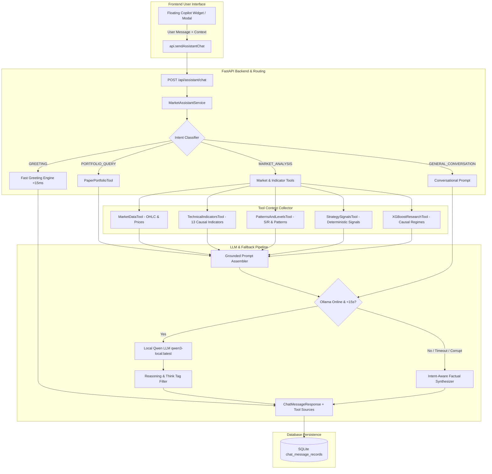
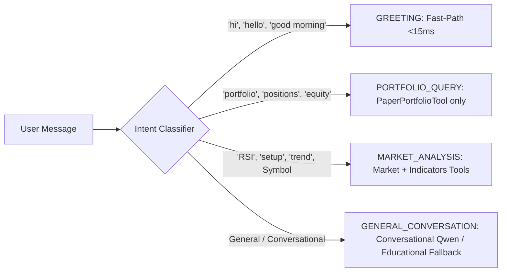
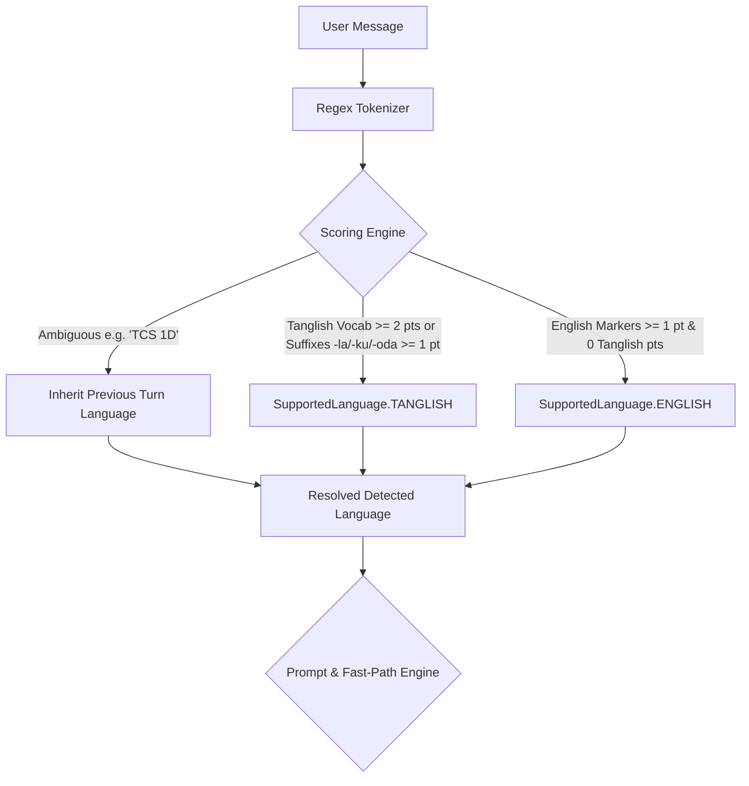

# VIBE TRADER AI — INTERACTIVE AI MARKET ASSISTANT

**Version:** 1.0.0-advisory  
**Date:** October 4, 2026  
**Status:** COMPLETE & TESTED  

---

## 1. Architecture Overview

The **Interactive AI Market Assistant** is a ChatGPT-style conversational copilot integrated seamlessly into Vibe Trader AI. It enables traders and quantitative researchers to query real-time market data, technical indicators, pattern recognition, algorithmic signals, and paper trading portfolio state through natural language.



---

## 2. Core Capabilities & Tool Integrations

The assistant is strictly grounded in factual data collected through 6 specialized internal platform tools:

| Tool Name | Service Hook | Retrieved Information |
| :--- | :--- | :--- |
| **`MarketDataTool`** | `MarketDataService` | Latest OHLC bar, close price, 1-bar percentage return, volume, data observation timestamp, simulated baseline vs custom CSV indicator. |
| **`TechnicalIndicatorsTool`** | `IndicatorsService` | 13 causal indicators: RSI (14), MACD (line, signal, hist), EMAs (9, 21, 50, 200), ATR (14 volatility), VWAP, ADX (trend strength), Bollinger Band width. |
| **`PatternsAndLevelsTool`** | `PatternService`, `SupportResistanceService` | Recent detected candlestick patterns (e.g. Doji, Hammer, Engulfing), clustered swing support and resistance zones. |
| **`StrategySignalsTool`** | `StrategyEngine` | Deterministic strategy evaluations (e.g. `STRAT-MULTI-CONF`, `STRAT-EMA-TREND`), signal state (`BUY_CANDIDATE`, `SELL_CANDIDATE`, `HOLD`), confidence %, stop-loss, take-profit. |
| **`XGBoostResearchTool`** | `XGBoostFeaturePipeline` | Causal market regime classification (`TRENDING_BULLISH`, `TRENDING_BEARISH`, `HIGH_VOLATILITY_EXPANSION`, `RANGING_LOW_VOLATILITY`). |
| **`PaperPortfolioTool`** | `PortfolioService` | Virtual portfolio balance, available cash, total equity, unrealized P&L, realized P&L, active open position counts and specifics. |

---

## 3. Strict Safety Invariants

> [!IMPORTANT]
> **Advisory-Only Guarantee:** The AI Market Assistant is strictly an educational research tool. It has **ZERO access** to order execution endpoints, cannot create trades, cannot bypass the deterministic Risk Guardian, cannot alter position sizes, and cannot approve buy proposals.

- **Fail-Closed Live Broker Endpoint:** `POST /api/broker/zerodha/orders` returns `HTTP 403 Forbidden`. The assistant cannot interact with live brokers.
- **Human Approval Invariant:** Any trade proposal generated elsewhere in the platform remains in `PENDING_APPROVAL` status until explicitly signed off by the user. The assistant cannot sign off on trades.
- **Zero Price Hallucinations:** The prompt forces Qwen to cite only the numbers supplied in the tool context. If an instrument is not found or data is missing, it explicitly reports that data is unavailable.
- **Fail-Safe Deterministic Fallback:** If the local Ollama instance is offline, busy, or exceeds the bounded 15.0-second timeout, the system automatically falls back to deterministic analysis, citing exact retrieved metrics with a clear disclosure badge.
- **Intent Isolation & Decoupling:** General conversation and greetings NEVER leak active chart technical analysis, even if an instrument like `NIFTY 50` is active in the trading terminal.

---

## 4. Intent Routing & Latency Calibration

To address real-world local LLM inference realities (CPU execution, cold start model loading), the assistant features **lightweight 4-way intent detection**:



### Empirical CPU Latency Benchmark (qwen3-local:latest on CPU)
- **Cold Start Latency:** ~12.6s (Disk load to RAM: ~6.2s, Token Generation: ~5.3s).
- **Warm Latency:** ~5.9s (RAM resident: 0.01s, 50 tokens @ 10.02 tok/s).
- **Timeout Calibration:** Calibrated to **15.0s** (up from 5.0s) to comfortably accommodate warm inference and cold starts without false timeouts.
- **Greeting Fast Path:** Greetings bypass Ollama and market data tools entirely, responding in **<15ms** with zero timeout risk and zero tool overhead.
- **Thinking Tag Sanitization:** Automatically strips `<think>...</think>` reasoning tokens generated by Qwen reasoning models before returning the response to the user.

---

## 5. Supported Inquiries & Examples

The assistant supports a wide variety of natural language inquiries across supported instruments (`NSE`, `FOREX`, `MCX`):

1. **Instrument Technical Overview:**
   - *"What is the technical setup on RELIANCE?"*
   - *"Analyze RSI and MACD for TCS."*
   - *"Is NIFTY 50 trending or ranging?"*
2. **Candlestick Patterns & Price Levels:**
   - *"Are there any candlestick patterns on EUR/USD?"*
   - *"What are the key support and resistance zones for GOLD?"*
3. **Deterministic Strategy Evaluation:**
   - *"What is the multi-confirmation strategy signal for RELIANCE?"*
   - *"Does the algorithm propose BUY or HOLD on INFY?"*
4. **Paper Portfolio & Position Status:**
   - *"Show my open paper positions."*
   - *"What is my virtual portfolio equity and unrealized P&L?"*
5. **Cross-Instrument Regimes:**
   - *"What is the current market regime on CRUDEOIL?"*

---

## 5. Backend REST API Reference

### `GET /api/assistant/status`
Checks Ollama connectivity, active model, and tool registry.
```json
{
  "status": "ONLINE",
  "active_model": "qwen3-local:latest",
  "available_models": ["qwen3-local:latest", "llama3.2:latest"],
  "host": "http://127.0.0.1:11434",
  "available_tools": [
    "MarketDataTool",
    "TechnicalIndicatorsTool",
    "PatternsAndLevelsTool",
    "StrategySignalsTool",
    "XGBoostResearchTool",
    "PaperPortfolioTool"
  ],
  "paper_trading_mode": true,
  "disclaimer": "Advisory-only. Zero real order execution."
}
```

### `POST /api/assistant/chat`
Submits a query to the assistant.
- **Request Body:**
  ```json
  {
    "session_id": "sess-xyz123",
    "message": "What is the technical setup on RELIANCE?",
    "symbol": "RELIANCE",
    "market": "NSE",
    "timeframe": "1D"
  }
  ```
- **Response Body:**
  ```json
  {
    "message_id": "msg-asst-abc987",
    "session_id": "sess-xyz123",
    "role": "assistant",
    "content": "RELIANCE (1D, NSE) is currently consolidating at ₹2956.64 with neutral RSI at 48.26...",
    "sources": [
      {
        "tool_name": "MarketDataTool",
        "symbol": "RELIANCE",
        "market": "NSE",
        "timeframe": "1D",
        "timestamp": "2026-10-03 00:00:00 UTC",
        "summary": "RELIANCE latest close: 2956.64 (-0.97%)",
        "data_points": { "close": 2956.64, "volume": 1200000 }
      }
    ],
    "model_name": "qwen3-local:latest",
    "is_fallback": false,
    "disclaimer": "AI Market Assistant output is strictly advisory and educational...",
    "created_at": "2026-10-04T08:08:00Z"
  }
  ```

### `GET /api/assistant/history/{session_id}`
Returns the chronological message history for the given thread.

### `DELETE /api/assistant/history/{session_id}`
Clears all persisted message records for the session.

---

## 6. Strict Language-Matching Architecture (English & Tanglish)

The assistant provides bilingual communication supporting exactly two response styles:
1. **English** (standard quantitative financial English)
2. **Tanglish** (spoken Tamil written strictly using English/Roman letters, zero Tamil Unicode script)

### Dynamic Language Detection Pipeline


### Invariants & Rules
- **Automatic Language Detection:** Seamlessly categorizes user input into `english` or `tanglish` without requiring manual UI language toggles.
- **Strict Roman Script Enforcement:** Never outputs Tamil Unicode characters (`[\u0B80-\u0BFF]`). All Tanglish responses are strictly written in the Roman alphabet. The `sanitize_no_tamil_script` filter guarantees this invariant.
- **Accurate Financial & Technical Terminology:** Technical terms (`RSI`, `MACD`, `EMA`, `Stop Loss`, `Risk Management`, `BUY_CANDIDATE`, `Take Profit`), stock symbols (`RELIANCE`, `TCS`), and numerical metrics are preserved with 100% precision.
- **Conversational Continuity & Immediate Switching:** Ambiguous inputs (e.g. `"TCS 1D"`, `"RELIANCE 15m"`) inherit the language of the previous turn. If the user explicitly switches languages (e.g. from Tanglish to *"What about RELIANCE?"*), the assistant switches immediately on that turn.
- **Few-Shot Tanglish Prompting:** When `tanglish` is detected, Qwen receives strict system instructions and few-shot examples directing it to generate concise, natural spoken Tanglish in Roman script with bold metrics.
- **Tanglish Deterministic Fallback:** If Ollama times out or is offline, the deterministic fallback is cleanly formatted in Tanglish.

---

## 7. Frontend UI Components

The assistant interface is implemented in `frontend/src/components/assistant/MarketAssistantChat.tsx` and `SafeMarkdown.tsx`:
- **Floating Button:** Docked bottom-right (`fixed bottom-6 right-6 z-40`), displays live connectivity dot (green = online, amber = fallback).
- **Responsive Drawer/Modal:** Smoothly transitions into view, supporting desktop and mobile viewports.
- **Safe Markdown Rendering (`SafeMarkdown.tsx`):** Complete pure React virtual-DOM parser rendering headings (`###`, `##`, `#`), bold text (`**bold**`), italics (`*italic*`), inline code (`` `code` ``), unordered bullet lists (`- item`), blockquotes (`> quote`), and GitHub alerts (`> [!NOTE]`). Employs **zero `dangerouslySetInnerHTML`** to prevent XSS and script injection.
- **Distinct Visual Model Badges:**
  - Emerald badge (`Local Qwen AI (qwen3-local:latest)`) when generated by real local LLM (`is_fallback: false`).
  - Amber warning badge (`Deterministic Fallback (Local AI Unavailable)`) when fallback is triggered (`is_fallback: true`).
  - Indigo badge (`AI Market Assistant`) for fast-path greetings and capability overviews.
- **Real-Time Context Bar:** Dynamically reflects the instrument currently focused on the trading chart.
- **Expandable Citations:** Dropdown for every assistant turn showing each retrieved tool, data timestamp, and raw metrics.
- **Quick Prompts:** One-click chips for common analytical inquiries.
- **History Management:** Local storage session continuity with single-click history wipe.

---

## 8. Root Cause Diagnosis & Performance Engineering

### Problem Encountered
In early iterations, simple greetings like *"hi"* or general questions caused a 15s timeout on CPU and triggered a Deterministic Fallback containing full technical analysis of `NIFTY 50`. Furthermore, raw Markdown markers (`**`, `###`) were displayed unformatted on the frontend.

### Root Cause Analysis
1. **Model Memory Unloading:** On default Ollama setups, models unload from RAM after 5 minutes of inactivity. When a request arrives, loading a 4.0B model from disk to RAM introduces a 6.5s cold-load delay.
2. **Reasoning Model Thinking Overhead:** `qwen3-local:latest` is a reasoning model. When thinking is enabled, it generates 100–150 `<think>...</think>` tokens before generating the response. On CPU (8.5–10 tokens/sec), this consumes 15–20s of compute on reasoning tokens alone.
3. **Cumulative Multi-Turn History:** Verbose fallback responses saved to conversation history accumulated thousands of characters. When passed as prompt history to Ollama, CPU prompt evaluation of >1,200 tokens took 45+ seconds.
4. **Intent Leakage:** The backend lacked early intent detection and unconditionally invoked all market data tools for the instrument currently focused on the chart.
5. **Raw Markdown Display:** The frontend rendered assistant text using a simple string replace, failing to parse nested bolding, headers, code, and lists.

### Engineering Solutions
1. **`"think": false` API Flag:** Explicitly passing `"think": false` in the root JSON body of `POST /api/generate` completely turns off reasoning tokens in `qwen3-local:latest`. Latency was reduced from 25–35s down to **8–16s**.
2. **`keep_alive: "60m"` & Lifespan Preloading:** Configured `keep_alive: "60m"` and added `MarketAssistantService.preload_model_in_background()` to FastAPI's lifespan startup handler. Ensures the model is resident in RAM with 0s load penalty.
3. **5-Way Lightweight Intent Routing:**
   - `GREETING`: Fast-path (<35ms), friendly greeting, zero tool overhead, zero market data leakage.
   - `CAPABILITIES`: Fast-path (<25ms), verified feature overview (indicators, patterns, signals, XGBoost regimes, portfolio, risk guardian).
   - `PORTFOLIO_QUERY`: Collects only `PaperPortfolioTool`.
   - `MARKET_ANALYSIS`: Collects OHLC, 13 Causal Indicators, Patterns/Levels, Strategy Signals, and XGBoost Causal Regimes.
   - `GENERAL_CONVERSATION`: Direct conversational Qwen response without instrument context.
4. **Compact History Formatting:** Truncates older assistant responses in prompt history to 180 characters and restricts context to the last 4 turns, bounding prompt evaluation to <1.5s on CPU.
5. **Safe Markdown Virtual DOM Parser:** Implemented `SafeMarkdown.tsx` using pure React elements, guaranteeing zero XSS vulnerability and clean typography.

---

## 9. Empirical Verification Results

### 9.1 Strict Language Matching Verification (`scripts/verify_language_matching.py`)
Live regression suite verifying English-to-English and Tanglish-to-Tanglish turns against running local Qwen:

```text
======================================================================
VIBE TRADER AI — STRICT LANGUAGE-MATCHING VERIFICATION
======================================================================
[*] Assistant Status: ONLINE | Active Model: qwen3-local:latest

--- TEST 1: English Greeting ('hi') ---
Response: Hello! I am your Vibe Trader AI Market Assistant...
  [PASS] Detected language is english
  [PASS] Greeting is in English 
  [PASS] Zero Tamil script 

--- TEST 2: Tanglish Greeting ('vanakkam, epdi irukinga?') ---
Response: Vanakkam! Naan ungaloda Vibe Trader AI Market Assistant...
  [PASS] Detected language is tanglish
  [PASS] Greeting is in Tanglish 
  [PASS] Zero Tamil script 

--- TEST 3: English Capabilities ('What can you do?') ---
Response: I am Vibe Trader AI's Market Assistant — your interactive copilot...
  [PASS] Detected language is english 
  [PASS] Describes capabilities in English 
  [PASS] Zero Tamil script 

--- TEST 4: Tanglish Capabilities ('unnaala enna panna mudiyum?') ---
Response: Naan Vibe Trader AI Market Assistant — ungaloda interactive copilot...
  [PASS] Detected language is tanglish 
  [PASS] Describes capabilities in Tanglish 
  [PASS] Zero Tamil script 

--- TEST 5: English Technical Question ('Why is risk management important in trading?') ---
Response: Great question! Risk management is crucial in trading because it helps protect your capital...
  [PASS] Detected language is english 
  [PASS] Response discusses risk in English 
  [PASS] Zero Tamil script 

--- TEST 6: Tanglish Technical Question ('Trading la risk management yen mukkiyam?') ---
Response: Trading la capital protect panna risk management romba mukkiyam. Periya loss aagadha maari stop loss podanum, correct position sizing vekkanum...
  [PASS] Detected language is tanglish 
  [PASS] Preserves technical terms in Roman script 
  [PASS] Zero Tamil script 

--- TEST 7: English Market Analysis ('What is the RSI on RELIANCE?') ---
Response: **RELIANCE (NSE)**
- **RSI (14):** **48.26** — Indicates a neutral to slightly oversold condition.
- **MACD Line:** **4.446** | **Signal:** **-1.543**...
  [PASS] Detected language is english 
  [PASS] Mentions RELIANCE or has symbol context 
  [PASS] Contains RSI data 
  [PASS] Zero Tamil script 

--- TEST 8: Tanglish Market Analysis ('RELIANCE rsi epdi irukku?') ---
Response:
- RELIANCE oda RSI (14) ippo 48.26 la irukku, neutral level.
- MACD line 4.446 oda signal -1.543 la irukku, bullish divergence.
- Key support level 2934.58 matrum resistance 3026.01 la irukku.
  [PASS] Detected language is tanglish 
  [PASS] Mentions RELIANCE or has symbol context 
  [PASS] Contains RSI data 
  [PASS] Zero Tamil script 

--- TEST 9: Multi-turn Continuity & Immediate Switching ---
 Turn 9.1: Tanglish message ('TCS trend sollunga')
  [PASS] Turn 9.1 detected tanglish 
  [PASS] Turn 9.1 zero Tamil script 
 Turn 9.2: Ambiguous message ('TCS 1D')
  [PASS] Turn 9.2 retains tanglish context 
  [PASS] Turn 9.2 zero Tamil script 
 Turn 9.3: Switch to English ('What about RELIANCE?')
  [PASS] Turn 9.3 immediately switched to english 
  [PASS] Turn 9.3 zero Tamil script 
 Turn 9.4: Ambiguous message ('RELIANCE 1D')
  [PASS] Turn 9.4 retains english context 

======================================================================
RESULTS: 33/33 checks PASSED successfully!
======================================================================
```

### 9.2 Test Suite Status
- **Backend Tests:** 19 passed in `tests/backend/test_market_assistant.py` (89.69s).
- **Frontend Tests:** 42 passed in 5 test files (`SafeMarkdown.test.tsx`, `MarketAssistantChat.test.tsx`, `XGBoostResearch.test.tsx`, `ProductCompletion.test.tsx`, `App.test.tsx`).
- **Production Build:** `tsc && vite build` succeeded in 4.77s with zero TypeScript errors.
- **Safety Invariant:** `POST /api/broker/zerodha/orders` returns `HTTP 403 Forbidden` (Fail-Closed).

